<!-- ANIMATED BANNER -->

<!-- ANIMATED TYPING -->

<!-- ALIGNED CONNECT BAR -->

<!-- ABOUT ME + ANIMATED DATA CORE -->
<table width="100%">
<tr>
<td width="64%" valign="middle">

<strong>About Me</strong>

I'm <b>Rehan Akhtar</b>, a <b>Data Analyst</b> based in <b>West Bengal, India</b>. I turn raw, multi-source datasets into clean data models, predictive insights, and executive-ready dashboards.

<ul>
<li><b>Role:</b> Data Analyst &amp; Full-Stack Developer</li>
<li><b>Focus:</b> BI Dashboards • ETL Pipelines • Predictive ML</li>
<li><b>Analytics:</b> Python, SQL, MySQL, Power BI, Advanced Excel, Pandas, Scikit-Learn</li>
<li><b>Web &amp; Dev:</b> JavaScript, PHP, HTML5, React, React Native, Git</li>
<li><b>Portfolio:</b> <a href="https://rehan-akhtar-portfolio.vercel.app/">rehan-akhtar-portfolio.vercel.app</a></li>
</ul>

</td>
<td width="36%" valign="middle" align="center">

</td>
</tr>
</table>

<h3>Tech Stack</h3>

<h3>Certifications</h3>

<h3>Trophies</h3>

<h3>GitHub Stats</h3>

<table width="100%">
<tr>
<td width="50%" valign="middle" align="center">

</td>
<td width="50%" valign="middle" align="center">

</td>
</tr>
</table>

<h3>Languages Stats</h3>

<h3>Activity Graph</h3>

<h3>Contribution Snake</h3>

<picture>
<source media="(prefers-color-scheme: dark)" srcset="https://raw.githubusercontent.com/rehanakhtar051181-boop/rehanakhtar051181-boop/output/github-contribution-grid-snake-dark.svg" />
<source media="(prefers-color-scheme: light)" srcset="https://raw.githubusercontent.com/rehanakhtar051181-boop/rehanakhtar051181-boop/output/github-contribution-grid-snake.svg" />

</picture>

<b>Snake Workflow (.github/workflows/snake.yml)</b>

name: Generate Contribution Snake

on:
  schedule:
    - cron: "0 */12 * * *"
  workflow_dispatch:
  push:
    branches:
      - main
      - master

permissions:
  contents: write

jobs:
  generate:
    runs-on: ubuntu-latest
    timeout-minutes: 10
    steps:
      - name: Generate GitHub Contribution Snake
        uses: Platane/snk/svg-only@v3
        with:
          github_user_name: rehanakhtar051181-boop
          outputs: |
            dist/github-contribution-grid-snake.svg
            dist/github-contribution-grid-snake-dark.svg?palette=github-dark

      - name: Push Snake to Output Branch
        uses: crazy-max/ghaction-github-pages@v4
        with:
          target_branch: output
          build_dir: dist
        env:
          GITHUB_TOKEN: ${{ secrets.GITHUB_TOKEN }}

