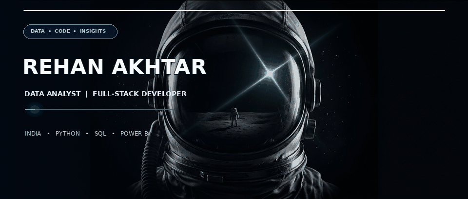
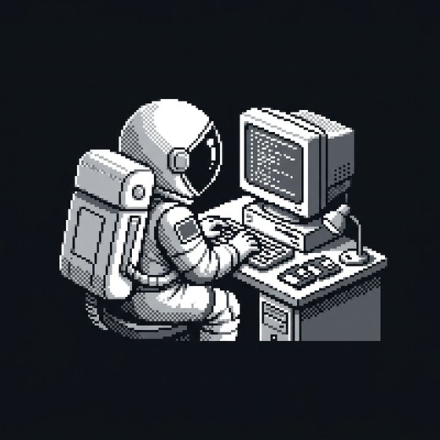

  

   

  

    

  
  
  

    

  

---

<table width="100%" border="0">
  <tr>
    <td width="66%" valign="middle">

<h2>🚀 About Me</h2>

Hi, I'm **Rehan Akhtar**, a **Data Analyst & Full-Stack Developer from India**.

I enjoy working with data, creating useful visualizations, and building web and mobile applications. I like combining analytical thinking with practical development to turn ideas into useful solutions.

- 📊 **Data Analytics:** SQL, Power BI, Advanced Excel, Pandas
- 💻 **Development:** Python, JavaScript, PHP, HTML5, React
- 📱 **Mobile:** React Native
- 🧰 **Tools:** MySQL, Git, Scikit-Learn
- 🌱 Always learning and improving my skills.
- 💬 Ask me about **Python, SQL, Power BI, Advanced Excel, and React**.

    </td>
    <td width="34%" align="center" valign="middle">
      
    </td>
  </tr>
</table>

---

<h2 align="center">🧠 Languages, Tools & Technologies</h2>

  <h3>Development</h3>

  

    

  <h3>Data Analytics</h3>

  
  
  
  
  
  

---

<h2 align="center">📊 GitHub Analytics</h2>

  
  

    

  

    

  

---

<h2 align="center">🐍 Contribution Snake</h2>

  <picture>
    <source media="(prefers-color-scheme: dark)" srcset="https://raw.githubusercontent.com/rehanakhtar051181-boop/rehanakhtar051181-boop/output/github-contribution-grid-snake-dark.svg" />
    <source media="(prefers-color-scheme: light)" srcset="https://raw.githubusercontent.com/rehanakhtar051181-boop/rehanakhtar051181-boop/output/github-contribution-grid-snake.svg" />
    
  </picture>

---

<h2 align="center">🤝 Connect With Me</h2>

  
  
  

    

  <b>“Turning data into insights and ideas into applications.”</b>

    

  Designed around the original astronaut theme.

